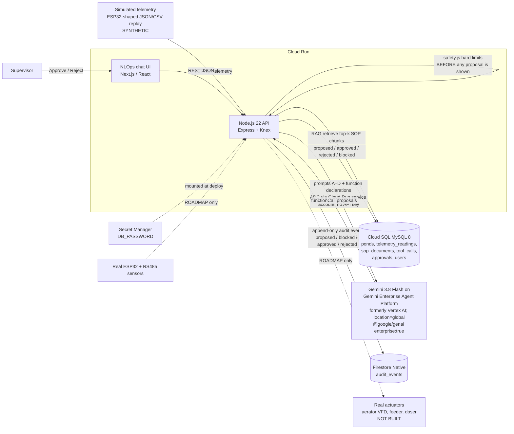

# SPEC: Sampay Aquaculture Co-Pilot (AI Builder Cup 2026)

Theme: **Future of Work & Enterprise Productivity.** Team: Ilfa Hidayat (leader, Indonesia), Alif Asraf (builder, Malaysia).
This SPEC gives enough to build the demo, and no more. Every science or market number comes from `/workspace/hackathon/sampay/source-validation.md` (the single source of truth). Thresholds live in `sop-thresholds.md` (draft; the Challenge Validator may overwrite it — if it does, the code constants must be updated from that file, not from memory).

**One-liner:** a Gemini agent that reads a (simulated) biofloc Nile tilapia pond feed, writes the supervisor a morning briefing in Bahasa Indonesia or English, proposes actions with SOP citations, refuses unsafe ones, and records every approved tool call in an audit log. Nothing touches real hardware.

## 1. Architecture



- **Why simulated telemetry:** we have ~3 days and no pond. A replayable CSV makes the DO-drop demo identical every take. Label it SIMULATED everywhere in the UI.
- **Why no actuators:** an "approved" action only writes `tool_calls.status='executed_simulated'`. The audit trail is the product for the Future-of-Work story (supervisor stays in charge; the agent does the paperwork and maths).
- **Why hard limits in code, not in the prompt:** a prompt can be ignored; `safety.js` cannot. Gemini proposes, code checks, a human approves.
- **Why RAG over MySQL, not a vector DB:** 4–5 short SOPs (~20 chunks). Store embeddings as JSON in MySQL and do cosine similarity in Node. Zero extra services. (Fallback if embeddings eat time: keyword match on chunk tags.)
- **Why Gemini via Agent Platform, not an AI Studio key:** official rules require "Google AI models (like Gemini or Gemma) or ... agentic platforms ... deployed on Google Cloud via Cloud Run or Firebase" (aibuildercup.com/themes.html); Agent Platform is the **safe reading** of the expert's "ultimately you have to use agent platform" (session 13:22), not a stated written rule. Calling Gemini through Agent Platform with the Cloud Run service identity also removes the only API key from the app, so there is nothing to leak (leaked secrets = disqualification, 28:01).
- **Why Firestore for the audit log while MySQL keeps telemetry:** telemetry is relational time series we query with SQL aggregates (MySQL fits). The audit trail is append-only, per-event documents that the judges should be able to trust; Firestore gives serverless writes, no schema migration for new event fields, and it is one of the services the host asked teams to explain (05:29). MySQL `tool_calls`/`approvals` stay the transactional source of truth (unique decision, status machine); Firestore `audit_events` is the immutable event stream the audit UI reads.
- **Why request-driven (no job queue):** the "morning briefing" is generated on demand (`POST /api/briefings`) or by Cloud Scheduler hitting the same endpoint (optional). Nothing long-running.

## 2. Demo flow (matches `samples/demo_script_seed.json`)
1. Replay `pond_A_do_drop.csv` (overnight DO falls to 2.4 mg/L at ~04:00 WIB).
2. Supervisor clicks "Briefing pagi" → Prompt A → BI briefing: DO dropped below 3 mg/L in Kolam A, other params in range, Kolam B OK.
3. Agent proposes `start_aerator(pond A, 120 min)` with citation (SDSU FS963-02) → supervisor Approves → audit row.
4. Supervisor types "tambah molase 0,2 g/L di kolam A" → **blocked** (exceeds 0.12 g/L, Pérez-Fuentes 2016; and DO ≤ 3) → Prompt D refusal, row `status='blocked'`.
5. Kolam B, TAN 1.0 mg/L: agent proposes molasses 0.045 g/L = 1.36 kg (Avnimelech 20 g carb/m³ per 1 ppm TAN, molasses 44% carb) → approve → audit.
6. Show audit log table.

## 3. Data model (Cloud SQL for MySQL 8, Knex migrations)

```sql
CREATE TABLE users (
  id            INT AUTO_INCREMENT PRIMARY KEY,
  name          VARCHAR(100) NOT NULL,
  role          ENUM('supervisor','operator') NOT NULL,  -- only supervisors may approve
  lang          ENUM('id','en') NOT NULL DEFAULT 'id',     -- default briefing language
  created_at    TIMESTAMP DEFAULT CURRENT_TIMESTAMP
);

CREATE TABLE ponds (
  id            VARCHAR(16) PRIMARY KEY,          -- 'A', 'B'
  name          VARCHAR(100) NOT NULL,            -- 'Kolam A (bioflok bundar)'
  volume_m3     DECIMAL(8,2) NOT NULL,            -- needed for dose maths (g/L × m³ → kg)
  species       VARCHAR(50) NOT NULL DEFAULT 'Oreochromis niloticus',
  max_feed_kg   DECIMAL(6,2) NULL,                -- farm-set cap per meal; NULL = no cap (no verified feeding rates)
  is_simulated  BOOLEAN NOT NULL DEFAULT TRUE
);

CREATE TABLE telemetry_readings (
  id            BIGINT AUTO_INCREMENT PRIMARY KEY,
  pond_id       VARCHAR(16) NOT NULL REFERENCES ponds(id),
  ts            DATETIME NOT NULL,                -- stored UTC; display WIB (UTC+7)
  do_mgL        DECIMAL(5,2),
  temp_c        DECIMAL(4,1),
  ph            DECIMAL(4,2),
  tan_mgL       DECIMAL(5,2),                     -- total ammonia nitrogen
  nh3_mgL       DECIMAL(6,3),                     -- un-ionised, supplied by simulator (see sop-thresholds.md)
  tds_ppm       INT,
  source        ENUM('simulated','device') NOT NULL DEFAULT 'simulated',
  INDEX idx_pond_ts (pond_id, ts)
);

CREATE TABLE sop_documents (
  id            INT AUTO_INCREMENT PRIMARY KEY,
  doc_key       VARCHAR(64) NOT NULL,             -- 'SOP-01-cn-molasses'
  chunk_no      INT NOT NULL,
  title         VARCHAR(200) NOT NULL,
  citation      VARCHAR(400) NOT NULL,            -- paper title + year, shown in UI
  content       TEXT NOT NULL,
  embedding     JSON,                             -- float array from Gemini embeddings; NULL → keyword fallback
  UNIQUE KEY uk_doc_chunk (doc_key, chunk_no)
);

CREATE TABLE tool_calls (
  id            BIGINT AUTO_INCREMENT PRIMARY KEY,
  pond_id       VARCHAR(16) NOT NULL REFERENCES ponds(id),
  tool_name     ENUM('start_aerator','set_feeder_kg','dose_molasses_gL') NOT NULL,
  args_json     JSON NOT NULL,
  rationale     TEXT,                             -- Gemini's reason
  citations     JSON,                             -- [{doc_key, chunk_no, citation}]
  safety_result JSON NOT NULL,                    -- {ok:bool, rule:'MOLASSES_MAX_GL', detail:'...'}
  status        ENUM('proposed','approved','rejected','blocked','executed_simulated') NOT NULL,
  model         VARCHAR(64),
  prompt_id     CHAR(1),                          -- 'A'..'D'
  created_at    TIMESTAMP DEFAULT CURRENT_TIMESTAMP
);

CREATE TABLE approvals (
  id            BIGINT AUTO_INCREMENT PRIMARY KEY,
  tool_call_id  BIGINT NOT NULL REFERENCES tool_calls(id),
  user_id       INT NOT NULL REFERENCES users(id),
  decision      ENUM('approved','rejected') NOT NULL,
  note          VARCHAR(500),
  decided_at    TIMESTAMP DEFAULT CURRENT_TIMESTAMP,
  UNIQUE KEY uk_one_decision (tool_call_id)       -- one decision per proposal
);
```

### 3b. Firestore (Native mode, same project, location asia-southeast2 or asia-southeast1 — both listed at https://cloud.google.com/firestore/docs/locations)
Collection `audit_events` (one document per event, auto ID, never updated or deleted by the app):
```js
{
  tool_call_id: number,        // FK to MySQL tool_calls.id — joins the two stores
  pond_id: 'A'|'B',
  event: 'proposed'|'blocked'|'approved'|'rejected'|'executed_simulated',
  tool_name: string, args: object,
  safety_result: {ok, rule, detail},
  citations: [{doc_key, chunk_no, citation}],
  actor: {user_id, role} | {agent: 'sampay', model, prompt_id},
  created_at: FieldValue.serverTimestamp(),   // server clock, not the client's
  simulated: true
}
```
Write order: MySQL transaction commits first, then Firestore `add()`. If the Firestore write fails, log + retry once and show a "audit sync pending" badge; never roll back the MySQL decision (MySQL is source of truth). Lock writes from browsers: Security Rules `allow read, write: if false;` — only the server (ADC, IAM `roles/datastore.user`) writes.

Optional: `briefings (id, pond_ids JSON, lang, body TEXT, facts_json JSON, model, created_at)` to cache Prompt A output for the video.

## 4. API (Node.js/Express, JSON, prefix `/api`)

| Method | Path | Purpose |
|---|---|---|
| GET | `/healthz` | Cloud Run health → `ok` |
| POST | `/api/telemetry` | ingest one reading or an array (simulator posts here) |
| POST | `/api/telemetry/replay` | `{file:'pond_A_do_drop.csv', speed:'instant'}` loads a sample file (dev/demo only, guarded by `DEMO_MODE=1`) |
| GET | `/api/ponds` / `/api/ponds/:id/telemetry?hours=24` | dashboard data |
| POST | `/api/briefings` | `{lang:'id'|'en'}` → Prompt A over last 24 h + SOP context; returns briefing + proposals |
| POST | `/api/chat` | `{message, lang?}` → Prompt B (intent) → Prompt C (propose) or Prompt D (refuse) |
| GET | `/api/tool-calls?status=` | audit log (MySQL state) |
| GET | `/api/audit-events?limit=50` | Firestore audit stream, newest first |
| POST | `/api/tool-calls/:id/approve` / `/reject` | supervisor only; 409 if status ≠ proposed; approve → `executed_simulated` |
| POST | `/api/demo/reset` | one-click clean state (see below) |
| POST | `/api/sop/ingest` | chunk + embed `samples/sop/*.md` (idempotent) |

**No login at all** (session 34:40; team decision 15 Oct). No auth header, no demo-user switch. Every approval is recorded as actor `{role:'demo_supervisor'}` (the seeded supervisor row, `users.id=1`, set server-side only) so the audit still names who decided. WHY: judges open the URL cold on an unscheduled day; any gate risks "app not working".
**Abuse guard instead of auth:** `express-rate-limit` on `POST /api/tool-calls/:id/approve|reject` (e.g. 10 req/min per IP — demo policy, not a sourced number) and on `/api/briefings`, `/api/chat` (protects Gemini quota). 429 → friendly "slow down" message.
**Reset demo:** `POST /api/demo/reset` (DEMO_MODE=1, rate-limited) → one MySQL transaction deletes tool_calls/approvals/briefings and re-runs replay for both ponds; then one Firestore `audit_events` doc `{event:'demo_reset'}` (Firestore stays append-only; the UI shows only events after the latest reset). One header button.

## 5. Background jobs
None required. Optional Cloud Scheduler → `POST /api/briefings` at 05:30 WIB. Replay runs in-request.

## 6. Gemini (`@google/genai`, model from env `GEMINI_MODEL`, default `gemini-3.8-flash`, temperature 0.2 for briefings, 0 for B/C/D)

**Client init — Gemini Enterprise Agent Platform (formerly Vertex AI), no API key:**
```js
import { GoogleGenAI } from '@google/genai';
// WHY enterprise:true: routes calls to Agent Platform (aiplatform.googleapis.com) instead of the
// AI Studio Gemini API, which the session says is required (13:22). Auth comes from ADC = the
// Cloud Run service account, so there is no key to store or leak.
// WHY location 'global': gemini-3.8-flash is only offered at global / us / eu (no APAC region).
export const ai = new GoogleGenAI({
  enterprise: true,
  project: process.env.GOOGLE_CLOUD_PROJECT,
  location: process.env.GOOGLE_CLOUD_LOCATION ?? 'global',
});
```
Equivalent env-only form (SDK README): `GOOGLE_GENAI_USE_ENTERPRISE=true`, `GOOGLE_CLOUD_PROJECT`, `GOOGLE_CLOUD_LOCATION=global`, then `new GoogleGenAI()`. The current SDK README documents `enterprise: true`; older samples use `vertexai: true` — whether `vertexai` is still accepted as an alias is **UNVERIFIED**, so use `enterprise`. Local dev: `gcloud auth application-default login`. Cloud Run: deploy with `--service-account=sampay-run@PROJECT.iam.gserviceaccount.com` granted `roles/aiplatform.user` (+ `roles/datastore.user`, `roles/cloudsql.client`, `roles/secretmanager.secretAccessor`). Enable the Agent Platform API (`aiplatform.googleapis.com`).
**Data location note (say it in README):** `global` requests "may be processed in any Google Cloud location" (no data-residency guarantee). Cloud Run, Cloud SQL and Firestore stay in asia-southeast2/1; only the Gemini call goes to `global`. Fine for SIMULATED data.
**503 / quota:** retry once with backoff; on failure show the cached last-good briefing labelled "cached" (session 39:27). Document limits in README (session 29:11).

Function declarations (all three ONLY insert into `tool_calls`; nothing physical):
```js
start_aerator    { pond_id: string, duration_min: integer(15..240), reason: string }
set_feeder_kg    { pond_id: string, kg: number(>=0), meal: 'pagi'|'siang'|'sore', reason: string }
dose_molasses_gL { pond_id: string, g_per_L: number(>0), tan_mgL_basis: number, reason: string }
```

**Prompt A — morning briefing** (input: per-pond 24 h stats JSON computed in Node: min/max/last for DO, pH, temp, TAN, NH3, time of DO min; plus top-6 SOP chunks; plus `lang`)
```
You are Sampay, a biofloc Nile tilapia co-pilot for a pond supervisor.
Write a morning briefing in {lang: Bahasa Indonesia | English}. Max 120 words.
Use ONLY the numbers in TELEMETRY_STATS and the limits in SOP_CONTEXT. Do not compute new chemistry.
For each pond: one line status (OK / PERHATIAN / BAHAYA), the out-of-range parameters with value and time (WIB), and the SOP limit with its citation in [brackets].
If an action is warranted, call the matching function (do not describe a dose without calling the function).
Say that data is SIMULATED.
Return JSON: {briefing: string, facts: [{pond_id, param, value, limit, status, citation}]}
```
Why: Node computes stats so Gemini never does arithmetic on 96 rows; the `facts` array is what `ground_truth.csv` checks.

**Prompt B — intent parse (BI/EN)**
```
Classify the supervisor message into one intent and extract slots. Message may be Bahasa Indonesia, English or mixed.
Intents: status_query | propose_action | explain_sop | other.
Slots: pond_id ('A','B'), tool ('start_aerator'|'set_feeder_kg'|'dose_molasses_gL'|null), amount (number|null), unit ('g/L'|'kg'|'min'|null), lang ('id'|'en').
Decimal comma "0,2" means 0.2. Return JSON only.
```

**Prompt C — propose action with citation + self safety check**
```
Given INTENT, latest TELEMETRY for the pond, and SOP_CONTEXT chunks (each with doc_key and citation),
call exactly one function if an action is justified, else none.
Your reason must quote the SOP limit and cite the chunk (doc_key + paper title/year).
Before calling, check: molasses g_per_L ≤ 0.12 and DO > 3 mg/L; aerator if DO ≤ 3 mg/L.
If your own check fails, do NOT call the function; reply with refuse=true and the rule.
Return JSON: {refuse: bool, rule?: string, explanation: string, citations: [...]}
```
Note: Gemini's self-check is a courtesy. `safety.js` runs anyway (§7) and wins.

**Prompt D — refusal of unsafe dose** (called when `safety.js` blocks)
```
The requested action was BLOCKED by a hard safety rule: {rule} ({detail}). Source: {citation}.
In {lang}, in ≤ 60 words, tell the supervisor it was blocked, why (quote the number and source),
and the safe alternative (e.g. run the aerator first; dose ≤ 0.12 g/L only after DO > 3 mg/L).
Never offer a way to bypass the rule.
```

## 7. Hard safety limits (`api/src/safety.js`, pure functions, unit tested)
Verified values from source-validation.md (mirrors `sop-thresholds.md`):

| Rule | Check | Action | Source |
|---|---|---|---|
| `MOLASSES_MAX_GL` | `g_per_L > 0.12` | BLOCK | Pérez-Fuentes et al. 2016, *Aquaculture* 452: > 0.12 g/L dropped DO 3.2 → 1–1.5 mg/L |
| `MOLASSES_LOW_DO` (policy) | latest `do_mgL ≤ 3` | BLOCK molasses | policy derived from the same paper + SDSU DO > 3 |
| `DO_TARGET_MIN` | `do_mgL ≤ 3` | propose `start_aerator` | SDSU FS963-02 (Mjoun et al. 2010): optimum > 3 mg/L |
| `NH3_OPT` | `nh3_mgL ≥ 0.05` → PERHATIAN; `≥ 0.1` → BAHAYA (growth depressed) | flag; propose molasses only if other rules pass | SDSU FS963-02 |
| `PH_RANGE` | `ph < 7 or > 9` | flag | SDSU FS963-02 |
| `TEMP_RANGE` | `< 22 or > 29 °C` | flag | SDSU FS963-02 |
| `AERATOR_DURATION` | 15–240 min | BLOCK outside | demo policy |
| `FEEDER_KG` | `kg ≥ 0` and `≤ ponds.max_feed_kg` if set | BLOCK | demo policy (no verified feeding rates) |

**Molasses suggestion maths (deterministic, Node, not Gemini):** Avnimelech 1999: 20 g carbohydrate per m³ removes 1 g N/m³.
`carb_g_per_m3 = 20 × TAN_to_remove_mgL` → `g_per_L = carb_g_per_m3 / 1000 / MOLASSES_CARB_FRACTION` (MOLASSES_CARB_FRACTION = 0.44, Silva 2017; Avnimelech 1999; see sop-thresholds.md) → `min(result, 0.12)`; `kg_total = g_per_L × volume_m3`. Example Kolam B (30 m³, TAN 1.0): 20 g/m³ ÷ 0.44 = 45.5 g/m³ = 0.045 g/L → 1.36 kg.

Every blocked attempt is still written to `tool_calls` with `status='blocked'` — the refusals are part of the audit story.

## 8. Stack
- Node.js 22, Express, `@google/genai`, Knex + `mysql2`, Zod (validate function-call args), Vitest.
- UI: Next.js (App Router) or Vite React — pick whichever is faster for you; one page: chat + pond cards + audit table.
- `@google-cloud/firestore` (server client, ADC) for `audit_events`.
- Cloud Run (asia-southeast2 Jakarta, or asia-southeast1), Cloud SQL MySQL db-f1-micro via the Cloud SQL connector / unix socket. Request timeout sized to the slowest briefing (session 26:26). Min instances 0 while building; `--min 1` on the web+API service for the judging window (billed while idle — see §8 cost), back to 0 after results.
- Secrets: only `DB_PASSWORD` in Secret Manager (no Gemini key exists). Never put secrets in `deploy.sh` flags, `.env` committed, the deck or the video (session 28:01: leaked secrets = DQ).
- Models: `gemini-3.8-flash` default; `gemini-3.1-flash-lite` for the cheap path (intent parse) — both listed on the Agent Platform **global** endpoint. Embeddings: whichever Gemini embedding model Model Garden lists for your project/location — check in the console, do not hard-code a name from memory.

**Cost notes (source-validation rows 7a–7c, Oct 2026):**
- Gemini per 1M tokens (input/output): 3.8 Flash $0.75/$3.75 through 31 Dec 2026 (then $1.50/$7.50); 3.1 Flash-Lite $0.25/$1.50. Free tier exists but "Used to improve our products: Yes" → use paid tier for real farm data.
- Cloud Run free tier: 2M requests, 180,000 vCPU-s, 360,000 GiB-s per month per billing account.
- Note: the Gemini prices above are from source-validation (Gemini API pricing). Agent Platform pricing for 3.8 Flash was **not re-verified** for this update — check https://cloud.google.com/vertex-ai/generative-ai/pricing before quoting a number.
- Cloud Run min instances: "Instances kept running using the minimum instances feature do incur billing costs" (https://cloud.google.com/run/docs/configuring/min-instances). Keep `--min 1` only for the judging window. No dollar figure verified.
- Firestore: small (tens of docs); cost not verified — state "within free quota expected, unverified" only if checked.
- Cloud SQL MySQL db-f1-micro: $0.0105/h ≈ $7.67/month compute + ~$0.34/GiB-month SSD; shared core, no SLA, not HA.

## 9. What is stubbed (say it in the README and the video)
- Telemetry is SIMULATED (replayed CSV). No ESP32, no RS485 in the demo.
- Actuators (aerator VFD, feeder, molasses doser) are ROADMAP; approve = audit row only.
- SOPs are SYNTHETIC summaries grounded in the cited papers; not an official KKP SOP.
- Audit events are dual-written (MySQL state + Firestore event stream); a Firestore failure shows "audit sync pending", it does not block the decision.
- No login (open demo); approvals attributed to a fixed demo supervisor; rate limits instead of auth.
- Pond view (optional F6) is a SIMULATED illustration driven by replay telemetry + approved commands, permanently badged SIMULATED. Un-ionised NH3 is supplied by the simulator, not computed.
- No claim of "zero hallucination": we say **Source-Grounded Biofloc Reasoning** (citations + code limits + human approval).

## 10. Banned claims (do not let Cursor or Gemini write these anywhere)
"70% of crop failures", "1.56 million tons" (unless the KKP portal is confirmed logged-in), "$275 BOM", "Zero-Hallucination", "$0.002/1k tokens". Market line to use: 1.37 Mt Nile tilapia in 2023 (KKP Satu Data via SEAFDEC 2025); ~940,000 fish-farming households (BPS ST2023).

## 11. Verified Google facts (checked 15 Oct 2026; cite these, not memory)
| Fact | Source |
|---|---|
| Vertex AI is now **Gemini Enterprise Agent Platform**; "Vertex AI API" → "Agent Platform API"; Agent Engine → Agent Runtime; Memory Bank / Sessions under Agent Platform | https://docs.cloud.google.com/gemini-enterprise-agent-platform/vertex-ai-name-changes ; https://docs.cloud.google.com/gemini-enterprise-agent-platform/release-notes ; https://cloud.google.com/blog/products/ai-machine-learning/introducing-gemini-enterprise-agent-platform |
| `gemini-3.8-flash` GA (2 Sep 2026); availability **global, us, eu only** — no asia-southeast1/2 regional endpoint | https://docs.cloud.google.com/gemini-enterprise-agent-platform/models/gemini/3-8-flash |
| `gemini-3.8-flash` and `gemini-3.1-flash-lite` listed on the global endpoint; global = no data-residency guarantee | https://docs.cloud.google.com/gemini-enterprise-agent-platform/resources/locations ; https://docs.cloud.google.com/gemini-enterprise-agent-platform/resources/data-residency |
| `@google/genai` init `{enterprise:true, project, location}` or env `GOOGLE_GENAI_USE_ENTERPRISE/GOOGLE_CLOUD_PROJECT/GOOGLE_CLOUD_LOCATION`; ADC auth; SDK 3.0.0 will require Node ≥ 22 | https://googleapis.github.io/js-genai/ |
| Grant `roles/aiplatform.user` to the Cloud Run service identity; Cloud Run uses ADC from the service identity | https://docs.cloud.google.com/gemini-enterprise-agent-platform/models/access-control ; https://docs.cloud.google.com/run/docs/securing/service-identity |
| Firestore Node client uses ADC (`new Firestore()`), `FieldValue.serverTimestamp()`; locations include asia-southeast1/2 | https://cloud.google.com/nodejs/docs/reference/firestore/latest/firestore/firestore ; https://cloud.google.com/firestore/docs/samples/firestore-data-set-server-timestamp ; https://cloud.google.com/firestore/docs/locations |
| Cloud Run min instances are billed while idle; set with `gcloud run services update SERVICE --min N` | https://cloud.google.com/run/docs/configuring/min-instances |
| ADK has a TypeScript SDK (`@google/adk`, `LlmAgent`, `FunctionTool` with zod); quickstart needs **Node 24.13+** | https://google.github.io/adk-docs/ ; https://google.github.io/adk-docs/get-started/typescript/ |

**UNVERIFIED:** whether `vertexai:true` is still an accepted alias; Agent Platform per-token price for 3.8 Flash; exact ADK-TS config for using Agent Platform (vs API key) and Sessions/Memory Bank from TS; whether "using Agent Platform" requires Agent Runtime/Sessions/Memory Bank or a Gemini call through Agent Platform is enough (session 13:45 lists those services as examples — ask support+aibuilder@hack2skill.com if in doubt).

## 12. Agent Platform managed service — evaluated 15 Oct 2026
- **ADK Sessions → `VertexAiSessionService` (Agent Platform Sessions):** docs list Python, Go, Java, Kotlin — **not TypeScript** (https://google.github.io/adk-docs/sessions/session/). ADK-TS + Agent Platform Sessions: **not available per docs**.
- **Memory Bank → `VertexAiMemoryBankService`:** Memory page lists TypeScript for MemoryService generally, but Memory Bank examples are Python only and it "requires an Agent Runtime instance on Agent Platform" (https://google.github.io/adk-docs/sessions/memory/). TS Memory Bank: **UNVERIFIED**.
- **Decision:** main path = Node + `@google/genai` → Gemini on Agent Platform (verified, §6). Stretch S3 = small **Python ADK** Cloud Run sidecar using `VertexAiSessionService` for chat history (verified for Python), only if S1–S2 are green. If not built, say honestly: "Agent Platform serves the model; Sessions/Memory Bank are roadmap".

## 13. Official rules (aibuildercup.com + T&C, fetched 15 Oct 2026; see ../official-rules-check.md) — these override the session notes
- Video **strictly under 3:00** → target **2:50** (session's "3–4 min" is wrong for us).
- Mandatory: live URL on Cloud Run/GCP/Firebase; video < 3 min (public YouTube/Vimeo/Drive); **public** GitHub repo; deck **as PDF** (architecture + business case); name the theme; **everything in English** → BI briefing shown with English captions/subtitles and an EN toggle.
- Fresh code written during the event timeline only. Team formation closed **14 Oct**. Deadline "Oct 18" / "before October 18", hour + zone UNVERIFIED → internal target end of 17 Oct MYT. "Brief description" field: UNVERIFIED (not on official pages).
